::: {.home-container .column-page}
::: {.home-inner}

::: {.home-float}
### NBIS Summer School
:::

## [RaukR • Data Science With R]{.large}
::: {style="margin-bottom:1em;"}
#### Master the R programming ecosystem on our annual 2 week summer school in Visby, Gotland, Sweden
:::

In Life Sciences and Bioinformatics, the R programming language is pivotal for data transformation, statistical analyses, and crafting publication-ready visualizations. This workshop goes beyond the basics, offering participants a comprehensive understanding of the R ecosystem. We explore best coding practices, code profiling, data wrangling, generating reports from notebooks and development of web apps using R.

:::
:::



## Workshops

All course materials from our previous workshops are open and accessible.

::: {.image-container .profile-effect}

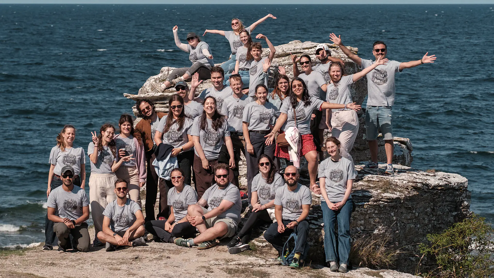{fig-alt="Group photo of teachers and participants at Hoburg"}

::: {.profile-overlay}
:::

::: {.group-logo .logo-2026}
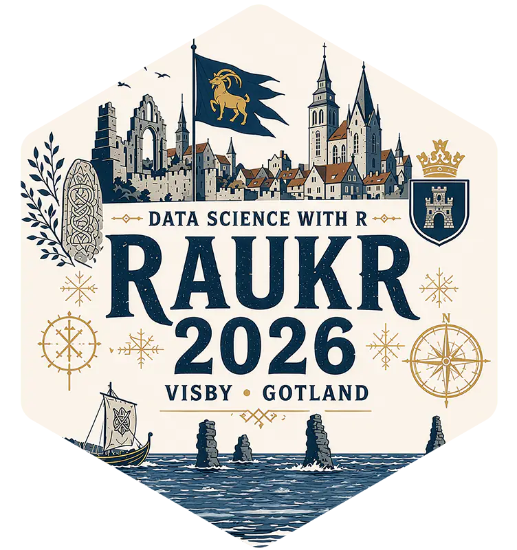{fig-alt="RaukR 2026 logo"}
:::

::: {.overlay-text}
[[RaukR 2026 &#9656;](https://nbisweden.github.io/raukr-2026/)]{.large}
:::

:::

::: {.image-container .profile-effect}

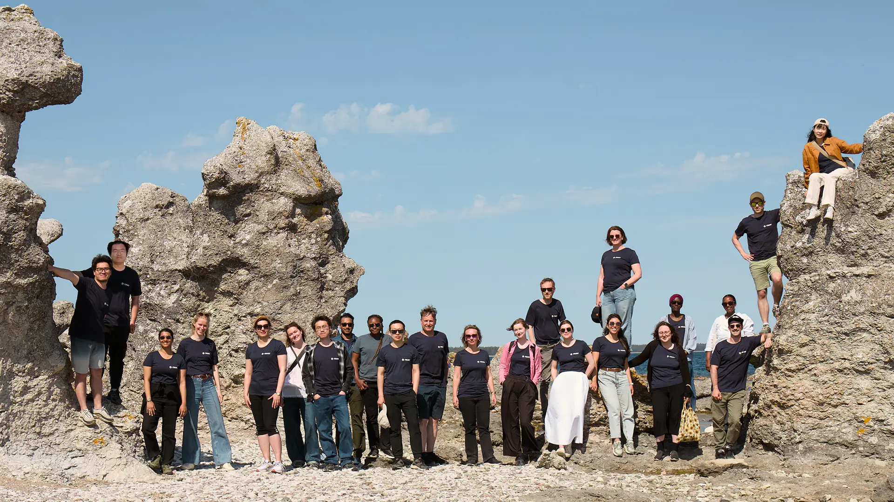{fig-alt="Group photo of teachers and participants with seastacks at Ljugarn"}

::: {.profile-overlay}
:::

::: {.group-logo .logo-2025}
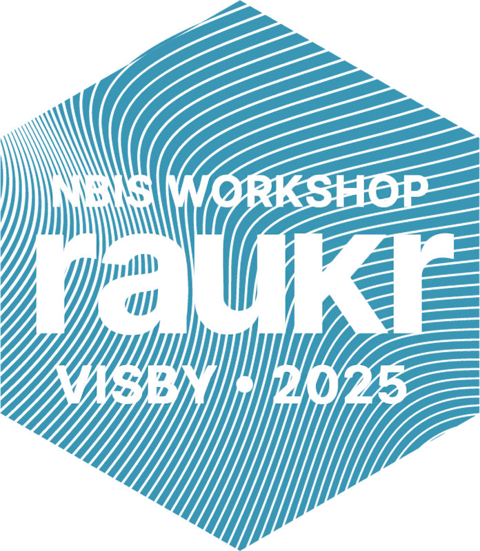{fig-alt="RaukR 2025 logo"}
:::

::: {.overlay-text}
[[RaukR 2025 &#9656;](https://nbisweden.github.io/raukr-2025/)]{.large}
:::

:::

::: {.image-container .profile-effect}

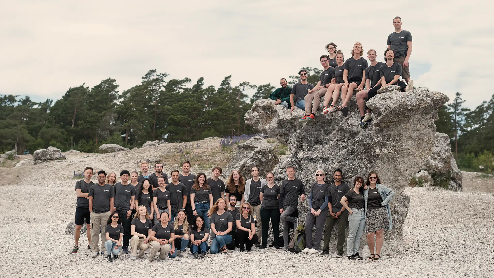{fig-alt="Group photo of teachers and participants with seastacks at Ljugarn"}

::: {.profile-overlay}
:::

::: {.group-logo .logo-2024}
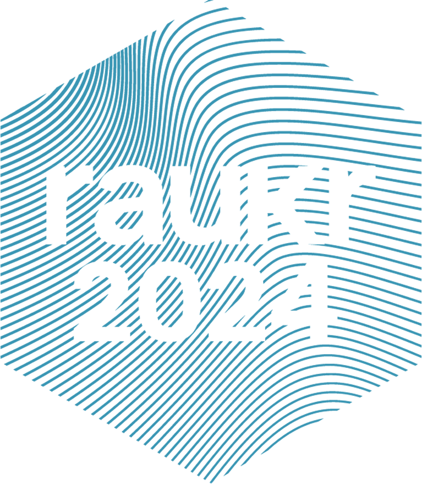{fig-alt="RaukR 2024 logo"}
:::

::: {.overlay-text}
[[RaukR 2024 &#9656;](https://nbisweden.github.io/raukr-2024/)]{.large}
:::

:::

::: {.image-container .profile-effect}

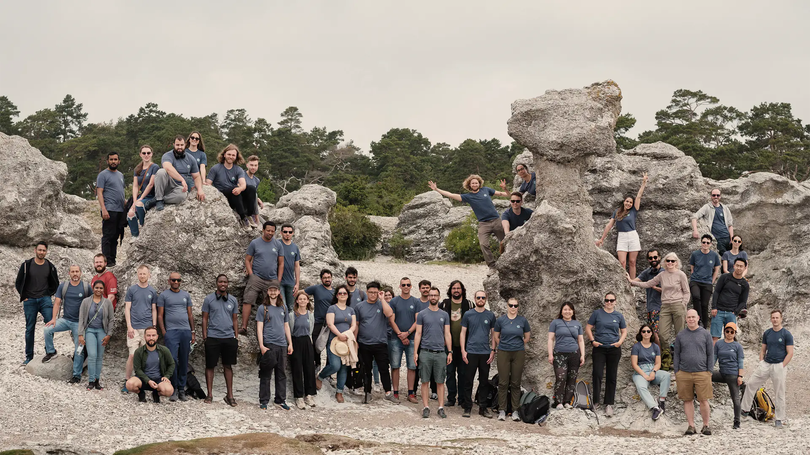{fig-alt="Group photo of teachers and participants with seastacks at Ljugarn"}

::: {.profile-overlay}
:::

::: {.group-logo .logo-2023}
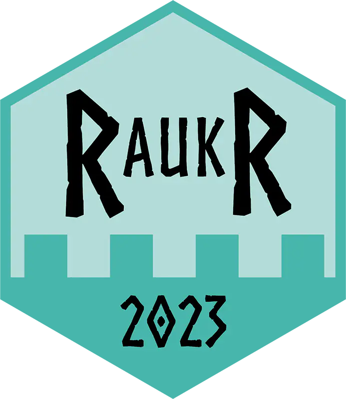{fig-alt="RaukR 2023 logo"}
:::

::: {.overlay-text}
[[RaukR 2023 &#9656;](https://nbisweden.github.io/raukr-2023/)]{.large}
:::

:::

## About

::: {.profile-effect}

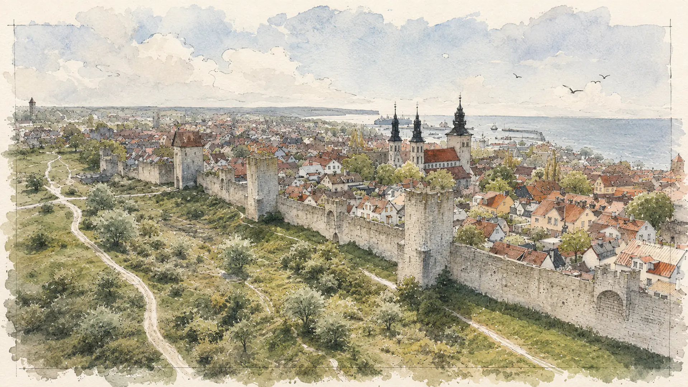{fig-alt="An aerial view of a medieval harbor with fishing vessels"}

::: {.profile-overlay}
:::

:::

RaukR summer school is run by the National Bioinformatics Infrastructure Sweden. [NBIS](https://nbis.se) is a platform of the Science for Life Laboratory ([SciLifeLab](https://www.scilifelab.se/)) and the Swedish node of [Elixir](https://elixir-europe.org/). This event is organised in co-operation with Campus Gotland, Uppsala University.

For queries, write to us at **raukr[at]nbis.se**.

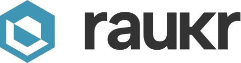{height="1.2em" style="margin-bottom:-3px;"} &nbsp; 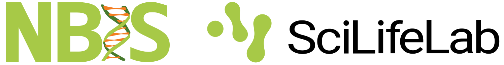{height="1.1em"} &nbsp; [](https://www.instagram.com/raukr_nbis/) &nbsp; [](https://bsky.app/profile/nbis.se) &nbsp; [](https://www.linkedin.com/company/nbisweden)

---

::: small
Updated:  at .
:::

<!-- typeform signup form -->

